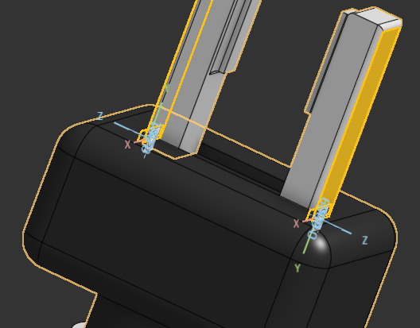
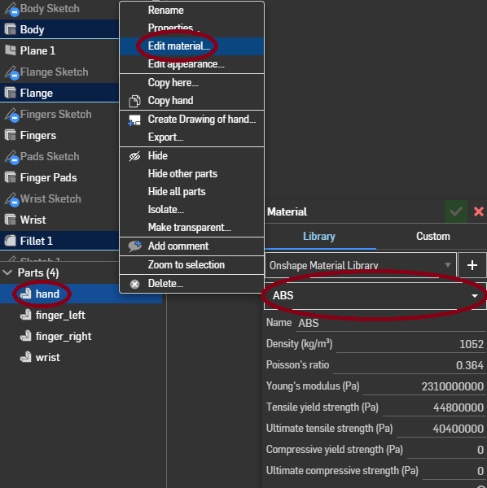

# Onshape Gripper Export to MuJoCo

This repository documents the workflow used to export an Onshape robotic gripper assembly to a MuJoCo model using [`onshape-to-robot`](https://github.com/Rhoban/onshape-to-robot).

The pipeline is:

```text
Onshape Assembly -> onshape-to-robot -> MuJoCo XML + meshes
```

`onshape-to-robot` retrieves the CAD assembly from Onshape through the Onshape API and exports robot description formats including URDF, SDF, and MuJoCo XML. See the official documentation: https://onshape-to-robot.readthedocs.io/en/latest/

## References

- Onshape: https://cad.onshape.com/
- Onshape Developer Portal: https://dev-portal.onshape.com/keys
- onshape-to-robot documentation: https://onshape-to-robot.readthedocs.io/en/latest/
- onshape-to-robot GitHub repository: https://github.com/Rhoban/onshape-to-robot
- MuJoCo website: https://mujoco.org/
- MuJoCo GitHub releases: https://github.com/google-deepmind/mujoco/releases

## 1. CAD preparation in Onshape

Open your robot or gripper assembly in Onshape.

For this tutorial, use the following Onshape Assembly:

```text
https://cad.onshape.com/documents/371b06a42f475c9907de5e85/w/adb936e8683c4e5f511239d8/e/13316bfea1db3d35234ddf73
```

The export must be performed from an **Assembly tab**, not from a Part Studio.

Copy the browser URL while the Assembly tab is active. The URL will be used later in `config.json`.

Example URL format:

```text
https://cad.onshape.com/documents/<DOCUMENT_ID>/w/<WORKSPACE_ID>/e/<ELEMENT_ID>
```

## 2. Joint naming convention

`onshape-to-robot` recognizes joints from Onshape mates using naming conventions.

Use:

```text
dof_<joint_name>
```

for movable joints.

Use:

```text
fix_<fixed_name>
```

for fixed connections.

Typical gripper example:

```text
fix_gripper_base
dof_wrist_rotation
dof_left_finger
dof_right_finger
```

For a gripper with two prismatic fingers:

```text
fix_gripper_base
dof_wrist_rotation
dof_left_finger
dof_right_finger
```

The expected exported joint types are:

| Onshape mate type | Name example | Exported joint type |
|---|---|---|
| Fastened mate | `fix_gripper_base` | Fixed connection |
| Revolute mate | `dof_wrist_rotation` | Revolute joint |
| Slider mate | `dof_left_finger` | Prismatic / slide joint |
| Slider mate | `dof_right_finger` | Prismatic / slide joint |

## 3. Joint axis convention

For `onshape-to-robot`, joint motion is defined with respect to the joint frame shown in Onshape when clicking the mate in the assembly tree.

The important convention is:

```text
Revolute mate -> rotation around local Z axis
Slider mate   -> translation along local Z axis
```

For a two-finger gripper, the prismatic axes should be physically consistent with the desired grasping direction.

For example, if both fingers should close when commanded with a positive value, the positive joint directions should point toward the center of the gripper:

```text
left finger  +Z -> center
right finger +Z -> center
```

In global coordinates, this usually means that the two prismatic axes are opposite.

## 4. Axis inversion using `_inv`

If a joint axis is oriented in the opposite direction, add the `_inv` suffix to the joint name.

Example:

```text
dof_right_finger_inv
```

This tells `onshape-to-robot` to invert the exported joint axis.

Example case:

```text
dof_left_finger
dof_right_finger_inv
```

Use this when one of the two prismatic axes is opposite to the desired exported convention.

If both prismatic mate Z axes point outward and positive motion should instead close the gripper inward, both may need inversion:



In the example above, both slider mate Z axes point outward from the gripper center. Since a grasp should move both fingers inward, both joints should use the `_inv` suffix:

```text
dof_left_finger_inv
dof_right_finger_inv
```

Do not add `_inv` blindly. First inspect the mate frame in Onshape by clicking the mate in the assembly tree and checking the Z axis direction.

## 5. Recommended Onshape mate setup for a simple gripper

For a gripper with one wrist revolute joint and two slider fingers:

```text
fix_gripper_base
dof_wrist_rotation
dof_left_finger_inv
dof_right_finger_inv
```

This assumes:

```text
left finger slider Z  -> outward
right finger slider Z -> outward
```

and the desired exported positive motion is inward closing.

If the slider Z axes already point inward, use:

```text
fix_gripper_base
dof_wrist_rotation
dof_left_finger
dof_right_finger
```

## 6. Add material to parts

Before exporting your own model, make sure you remembered to assign a material to each part in the Onshape Part Studio. In the tutorial document linked above, this has already been done.



Right-click each part, select **Edit material...**, and choose a material from the Onshape material library.

This is important because the material density gives each part a mass. MuJoCo needs valid masses and inertial properties to simulate the exported model correctly.

## 7. Create Onshape API keys

Go to:

```text
https://dev-portal.onshape.com/keys
```

Create a new API key pair.

You need:

```text
ONSHAPE_ACCESS_KEY
ONSHAPE_SECRET_KEY
```

Keep the secret key private. Do not commit it to GitHub.

## 8. Install MuJoCo

Official MuJoCo website:

```text
https://mujoco.org/
```

Official MuJoCo releases:

```text
https://github.com/google-deepmind/mujoco/releases
```

You can either install MuJoCo from the official release binaries or use the Python package if your workflow is Python-based.

Python installation:

```bash
pip install mujoco
```

Verify the Python installation:

```bash
python -c "import mujoco; print(mujoco.__version__)"
```

If using the native MuJoCo viewer, make sure the MuJoCo executable directory is available in your system `PATH`.

## 9. Install onshape-to-robot

Install with pip:

```bash
pip install onshape-to-robot
```

or:

```bash
python -m pip install onshape-to-robot
```

Check that the command is available:

```bash
onshape-to-robot --help
```

If the command is not found on Windows, the Python Scripts directory is probably not in `PATH`.

Typical Windows Scripts path:

```text
C:\Users\<USER>\AppData\Local\Packages\PythonSoftwareFoundation.Python.<VERSION>\LocalCache\local-packages\Python<VERSION>\Scripts
```

Add that directory to the user `PATH`, then close and reopen the terminal.

## 10. Ubuntu setup

Create a project directory:

```bash
mkdir my-robot
cd my-robot
```

Create a `.env` file:

```bash
nano .env
```

Add:

```bash
ONSHAPE_API=https://cad.onshape.com
ONSHAPE_ACCESS_KEY=LA_TUA_ACCESS_KEY
ONSHAPE_SECRET_KEY=LA_TUA_SECRET_KEY
```

Alternatively, export the variables in your shell:

```bash
export ONSHAPE_API=https://cad.onshape.com
export ONSHAPE_ACCESS_KEY=LA_TUA_ACCESS_KEY
export ONSHAPE_SECRET_KEY=LA_TUA_SECRET_KEY
```

To make them permanent, add them to `~/.bashrc`:

```bash
echo 'export ONSHAPE_API=https://cad.onshape.com' >> ~/.bashrc
echo 'export ONSHAPE_ACCESS_KEY=LA_TUA_ACCESS_KEY' >> ~/.bashrc
echo 'export ONSHAPE_SECRET_KEY=LA_TUA_SECRET_KEY' >> ~/.bashrc
source ~/.bashrc
```

Verify:

```bash
echo $ONSHAPE_API
echo $ONSHAPE_ACCESS_KEY
echo $ONSHAPE_SECRET_KEY
```

## 11. Windows setup

Create the project directory:

```cmd
cd %USERPROFILE%\Documents
mkdir my-robot
cd my-robot
```

Create a `.env` file:

```cmd
notepad .env
```

Add:

```text
ONSHAPE_API=https://cad.onshape.com
ONSHAPE_ACCESS_KEY=LA_TUA_ACCESS_KEY
ONSHAPE_SECRET_KEY=LA_TUA_SECRET_KEY
```

Do not use `export` in Windows `.env` files.

Correct:

```text
ONSHAPE_ACCESS_KEY=LA_TUA_ACCESS_KEY
```

Incorrect:

```text
export ONSHAPE_ACCESS_KEY=LA_TUA_ACCESS_KEY
```

You can also set the variables globally using `setx`:

```cmd
setx ONSHAPE_API "https://cad.onshape.com"
setx ONSHAPE_ACCESS_KEY "LA_TUA_ACCESS_KEY"
setx ONSHAPE_SECRET_KEY "LA_TUA_SECRET_KEY"
```

After using `setx`, close the terminal and open a new one.

Verify:

```cmd
echo %ONSHAPE_API%
echo %ONSHAPE_ACCESS_KEY%
echo %ONSHAPE_SECRET_KEY%
```

If you want to set the variables only for the current terminal session:

```cmd
set ONSHAPE_API=https://cad.onshape.com
set ONSHAPE_ACCESS_KEY=LA_TUA_ACCESS_KEY
set ONSHAPE_SECRET_KEY=LA_TUA_SECRET_KEY
```

## 12. Create `config.json`

Inside the project directory:

```bash
my-robot/
├── .env
└── config.json
```

Create `config.json`.

Ubuntu:

```bash
nano config.json
```

Windows:

```cmd
notepad config.json
```

Minimal MuJoCo configuration:

```json
{
  "url": "https://cad.onshape.com/documents/371b06a42f475c9907de5e85/w/adb936e8683c4e5f511239d8/e/13316bfea1db3d35234ddf73",
  "output_format": "mujoco"
}
```

This URL points to the Onshape Assembly used in this tutorial. For your own robot, replace it with the Assembly URL copied from Onshape.

If the Onshape document contains more than one assembly, specify the assembly name:

```json
{
  "url": "https://cad.onshape.com/documents/<DOCUMENT_ID>/w/<WORKSPACE_ID>/e/<ELEMENT_ID>",
  "output_format": "mujoco",
  "assembly_name": "Assembly 1"
}
```

## 13. Run the export

From the directory containing `my-robot`:

Ubuntu:

```bash
cd ..
onshape-to-robot my-robot
```

Windows:

```cmd
cd %USERPROFILE%\Documents
onshape-to-robot my-robot
```

If Windows cannot find `onshape-to-robot`, run it with the full path to the installed executable or fix the Python Scripts directory in `PATH`.

Example:

```cmd
"C:\Users\<USER>\AppData\Local\Packages\PythonSoftwareFoundation.Python.<VERSION>\LocalCache\local-packages\Python<VERSION>\Scripts\onshape-to-robot.exe" my-robot
```

## 14. Expected output

After a successful export, the project directory should contain generated robot files and assets.

Example structure:

```text
my-robot/
├── .env
├── config.json
├── robot.xml
└── assets/
```

The exact generated filenames may depend on the exporter version and configuration.

## 15. Test in MuJoCo

If the MuJoCo viewer is available from the terminal:

```bash
simulate my-robot/robot.xml
```

On Windows:

```cmd
simulate my-robot\robot.xml
```

If `simulate` is not found, add the MuJoCo binary directory to `PATH`, or open the XML using your MuJoCo installation manually.

## 16. Check the exported joints

Open the generated MuJoCo XML and inspect the joints.

Expected examples:

```xml
<joint name="wrist_rotation" type="hinge" ... />
<joint name="left_finger" type="slide" ... />
<joint name="right_finger" type="slide" ... />
```

For a gripper, verify:

```text
positive left_finger motion  -> closes toward center
positive right_finger motion -> closes toward center
```

If both fingers open instead of closing, invert both prismatic joints in Onshape naming:

```text
dof_left_finger_inv
dof_right_finger_inv
```

If one finger closes and the other opens, invert only the wrong one.

Example:

```text
dof_left_finger
dof_right_finger_inv
```

or:

```text
dof_left_finger_inv
dof_right_finger
```

## 17. Common errors

### `ERROR: No Onshape API access key are set`

The environment variables are not visible to the current terminal.

On Windows, if you used:

```cmd
setx ONSHAPE_ACCESS_KEY "LA_TUA_ACCESS_KEY"
```

you must close and reopen the terminal.

Check:

```cmd
echo %ONSHAPE_ACCESS_KEY%
```

On Ubuntu, check:

```bash
echo $ONSHAPE_ACCESS_KEY
```

### `onshape-to-robot is not recognized as an internal or external command`

The Python Scripts directory is not in `PATH`.

Fix the `PATH`, reopen the terminal, and try again.

### The export uses the wrong Onshape tab

Make sure the URL in `config.json` points to the Assembly tab, not the Part Studio tab.

### Fingers move in the wrong direction

Check the Z axis of the Slider Mate frame in Onshape.

Use `_inv` on the corresponding joint name if the exported direction is opposite to the desired direction.

### The robot has unexpected fixed or missing joints

Check the mate names.

Movable joints must start with:

```text
dof_
```

Fixed links should start with:

```text
fix_
```

## 18. Security note

Never commit `.env` files or API keys to GitHub.

Add `.env` to `.gitignore`:

```gitignore
.env
```

If an API secret key is accidentally shared publicly, revoke it immediately from the Onshape Developer Portal and generate a new key pair.